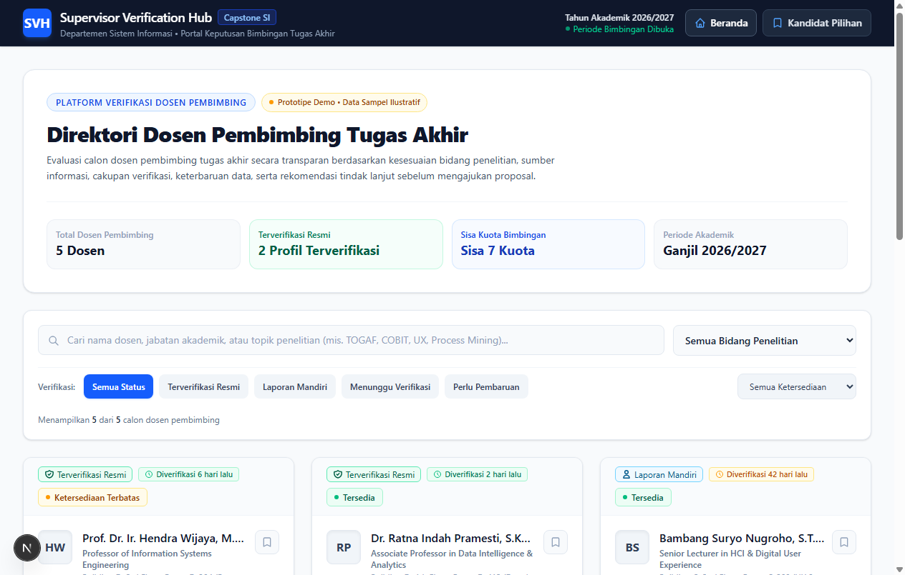
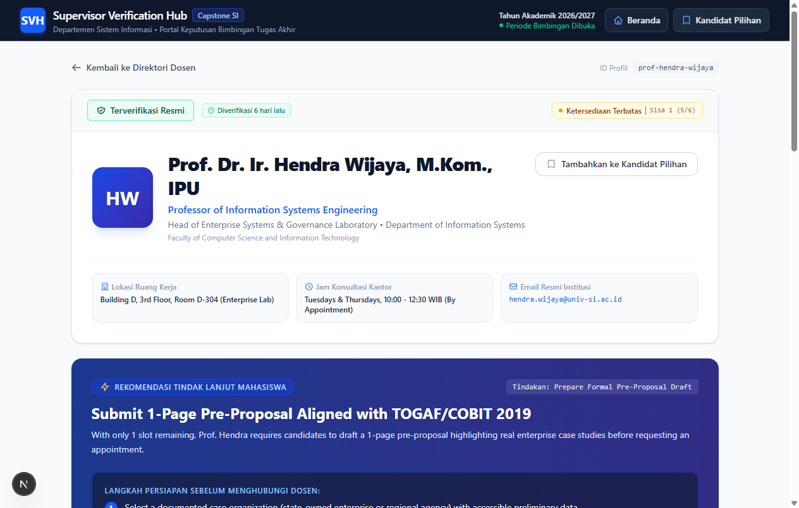
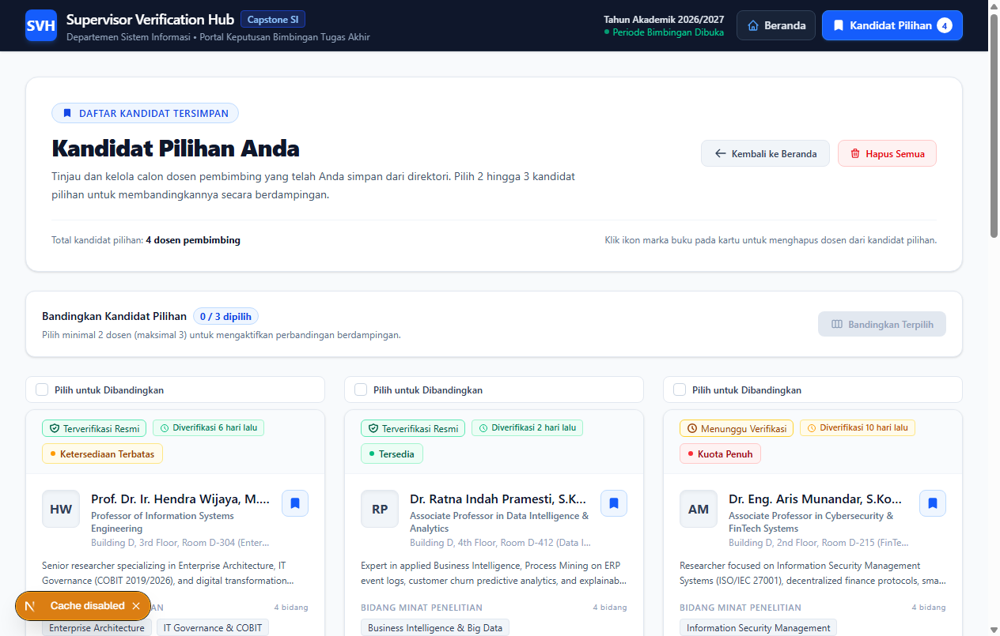
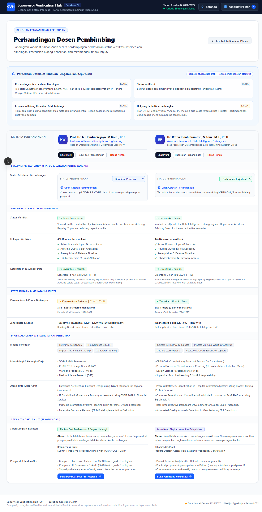
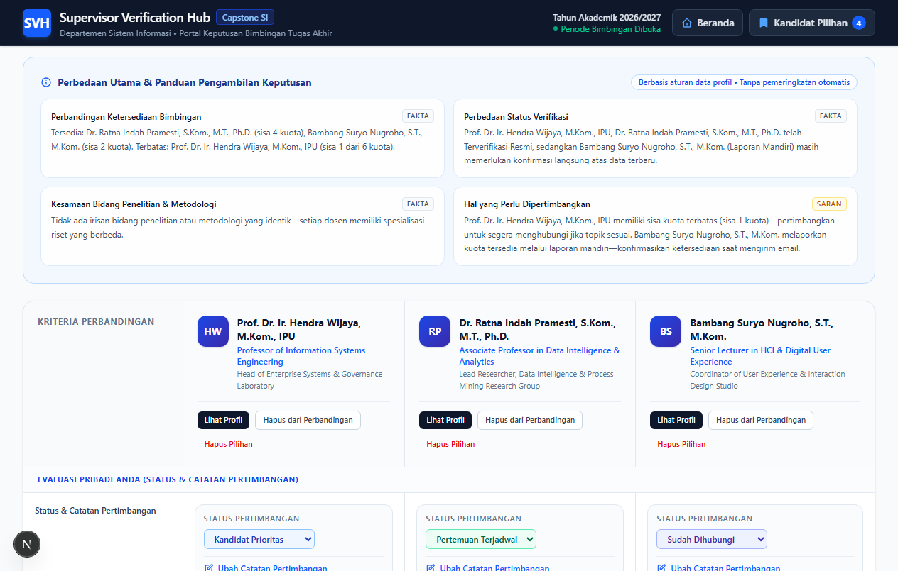
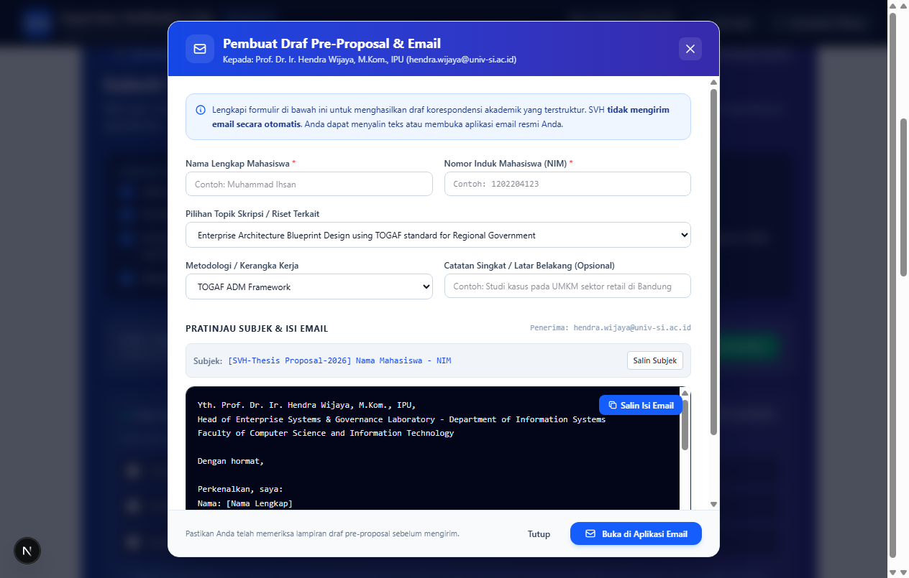
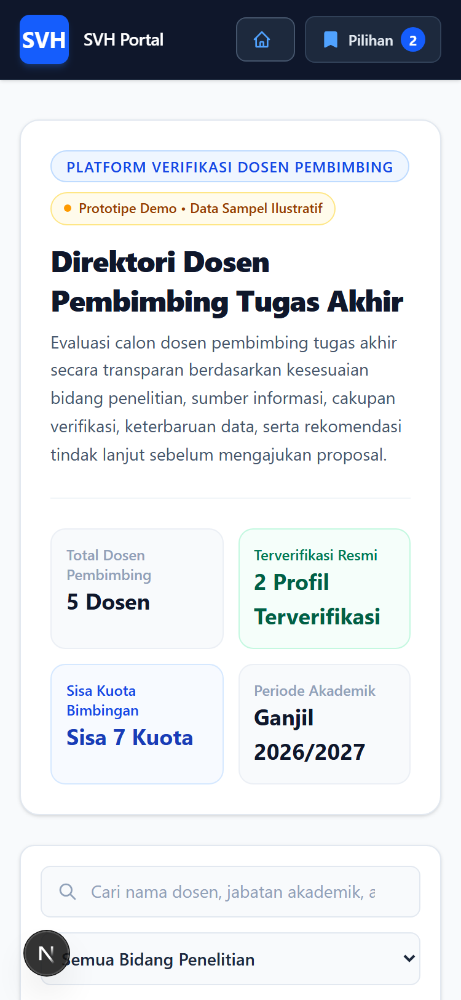

# Supervisor Verification Hub (SVH)

**Supervisor Verification Hub (SVH)** is a web-based decision-support prototype designed for undergraduate Information Systems students who are evaluating, comparing, and preparing to approach potential thesis supervisors.

Instead of relying on informal word-of-mouth or static faculty listings, SVH organizes supervisor profiles around transparent verification indicators, advising availability, research methodology alignment, personal shortlisting, side-by-side comparison, and structured outreach preparation—all in an Indonesian-language student interface.

> **Demo Notice:** All supervisor profiles, institutional reference codes, verification statuses, and advising quotas in this prototype are **illustrative sample data** (`src/data/mockSupervisors.ts`). SVH is a standalone front-end prototype and does **not** connect to SIAKAD or any live university database.

---

## Problem

Students preparing for their undergraduate thesis commonly face several practical hurdles when choosing a supervisor:

- **Uncertain availability:** It is difficult to know which faculty members still have open advising capacity, have limited slots, or are on academic leave before investing time in a proposal.
- **Fragmented evaluation criteria:** Research focus areas, preferred methodologies (e.g., TOGAF ADM, CRISP-DM, ISO 9241-210, ISO/IEC 27001), prerequisites, and office hours are rarely presented in one structured view.
- **Difficulty comparing candidates:** Evaluating trade-offs across multiple promising supervisors—such as verified vs. self-reported data or open vs. limited capacity—is cumbersome without a side-by-side view.
- **Unstructured outreach preparation:** Students often lack clear guidance on whether to send an inquiry email, prepare a pre-proposal draft, attend office consultation hours, or explore a co-supervisor arrangement.

---

## Solution

SVH supports a structured, non-linear decision workflow:

**Beranda (Search & Filter) → Profil Dosen → Kandidat Pilihan (Shortlist) → Perbandingan (Compare) → Evaluasi (Status & Notes) → Pusat Tindak Lanjut (Action Hub)**

Students can freely explore faculty profiles, save promising candidates to a persistent browser shortlist, compare 2–3 shortlisted supervisors side-by-side with rule-based **Fakta** vs. **Saran** guidance (with zero fabricated match scores or automated rankings), record personal decision statuses and notes, and launch tailored outreach or consultation preparation tools.

---

## Key Features

- **Direktori Dosen Pembimbing (`/`):** Overview KPIs and scannable faculty cards showing verification status, freshness, availability, research fields, verification scope snapshot, and recommended next action.
- **Live Search & Multi-Dimensional Filtering:** Instant client-side search across names, titles, research fields, thesis topics, bios, and methodologies, combined with verification status pills, research field filter, availability filter, and one-click reset.
- **Profil Verifikasi Dosen (`/supervisors/[id]`):** Complete breakdown of verification scope (`X dari Y Terkonfirmasi`), source citations, freshness timestamps, research fit, thesis focus examples, methodologies, and advising quota capacity.
- **Kandidat Pilihan / Shortlist (`/shortlist`):** Add or remove supervisors from any card or detail page, synced with a live navbar counter badge and persisted in `localStorage`.
- **Perbandingan Berdampingan (`/compare`):** Compare 2–3 shortlisted supervisors side-by-side with a sticky criteria column on desktop/tablet and stacked criterion-aligned cards on mobile.
- **Status & Catatan Pertimbangan:** Assign personal decision statuses (`Dipertimbangkan`, `Kandidat Prioritas`, `Sudah Dihubungi`, `Pertemuan Terjadwal`, `Tidak Dilanjutkan`) and save private decision notes per candidate, synced across `/shortlist` and `/compare`.
- **Panduan Pengambilan Keputusan (Rule-Based):** Transparent, deterministic insights distinguishing **Fakta** (availability contrast, verification differences, exact shared fields/methodologies) from **Saran** (actionable considerations with explicit **"Alasan:"** rationales).
- **Pusat Tindak Lanjut (Action Execution Hub):** Adaptive workflows per supervisor—formal Indonesian pre-proposal/email draft generator, office consultation preparation planner, co-supervisor pathway guide, sabbatical alternative discovery, and interactive prerequisite self-assessment checklist.

---

## Screenshots (Indonesian UI)

| Beranda & Direktori | Profil Verifikasi Dosen |
| :---: | :---: |
|  |  |

| Kandidat Pilihan (Shortlist) | Perbandingan 2 Dosen |
| :---: | :---: |
|  |  |

| Panduan Pengambilan Keputusan | Pusat Tindak Lanjut (Draf Email) |
| :---: | :---: |
|  |  |

| Pengalaman Mobile (375px) |
| :---: |
|  |

> Full documentation and additional desktop/mobile evidence are available in [`docs/README.md`](./docs/README.md).

---

## Technical Stack

- **Framework:** Next.js `16.4.6` (App Router)
- **UI Library:** React `19.3.0`
- **Language:** TypeScript `^5`
- **Styling:** Tailwind CSS `4.3.3`
- **Linting:** ESLint `^9` (`eslint-config-next@16.4.6`)

---

## Architecture

- **Routes:** `/` (Directory), `/supervisors/[id]` (Profile & Action Hub + `not-found.tsx`), `/shortlist` (Shortlist & Selection), `/compare` (Dynamic `?ids=...` Side-by-Side Comparison).
- **Shared State & Persistence:** `ShortlistProvider` (`src/context/ShortlistContext.tsx`) mounted in `src/app/layout.tsx` uses React 19's `useSyncExternalStore` to sync `svh-shortlist`, `svh-decision-statuses`, and `svh-decision-notes` with `localStorage` safely (hydration-safe, cross-tab synced, resilient to malformed JSON).
- **Decision Engine:** Pure, deterministic rule-based logic in `src/lib/decisionGuidance.ts` with zero external AI calls or fabricated scores.
- **Full Technical Docs:** See [`docs/technical-architecture.md`](./docs/technical-architecture.md).

---

## Testing & QA

- **Full System QA (Live Headless Chrome CDP against production `npm start`):** **38 / 38 PASS** across Dashboard, Search, Filtering, all 5 Detail Pages + 404, all 5 Action Hub workflows, Shortlist, Comparison, Decision Support, Persistence, Responsive (`1280px`, `768px`, `375px`), and Technical health (0 runtime exceptions, 0 hydration errors, 0 console errors, 0 failed network requests).
- **Static Analysis:** `npm run lint` (0 errors, 0 warnings) and `npx tsc --noEmit` (0 errors).
- **Production Build & Runtime Verification:** `npm run build` (`next build --webpack`) and `npm start` verified cleanly.
- **Detailed QA Report:** See [`docs/testing-and-qa.md`](./docs/testing-and-qa.md).

---

## Limitations

- **Illustrative Mock Dataset:** Profiles, verification codes, and quotas in `src/data/mockSupervisors.ts` are sample demonstration data, not live institutional records.
- **No Institutional Integration / Backend:** SVH does not connect to SIAKAD, university APIs, or a database.
- **Browser-Local Storage Only:** Shortlist selections, decision statuses, and personal notes are stored locally in the user's browser and do not sync across devices.
- **No Automated Verification or Email Dispatch:** Prerequisite checks are self-assessments (no transcript validation), and email drafts copy to clipboard or open `mailto:` in the user's own email client.

---

## Running Locally

```bash
# 1. Install dependencies
npm install

# 2. Run development server (http://localhost:3000)
npm run dev

# 3. Validate lint and TypeScript
npm run lint
npx tsc --noEmit

# 4. Build and run production server
npm run build
npm start
```

---

## Deployment Readiness (Vercel)

SVH is ready for standard Next.js deployment on **Vercel**:

- **Framework Preset:** Next.js (auto-detected)
- **Build Command:** `npm run build`
- **Output Directory:** `.next`
- **Environment Variables Required:** **None** (zero API keys, database URLs, or secrets required)

---

## Project Status

**Functional Prototype — Portfolio & Demonstration Ready.**  
Developed as an Information Systems capstone prototype (`Q3.04`) with verified production build, full Indonesian UI localization, automated browser QA, and complete documentation in [`docs/`](./docs/README.md).
