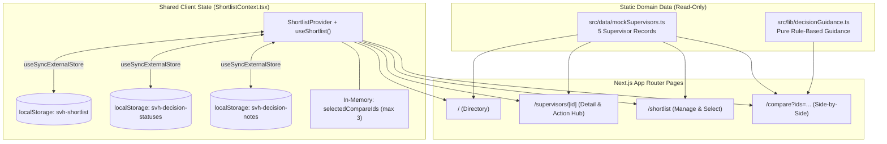

# Technical Architecture

This document reflects the actual implemented codebase in `supervisor-verification-hub`.

---

## 1. Tech Stack & Versions (from `package.json`)

| Layer | Technology | Version |
| --- | --- | --- |
| Framework | Next.js (App Router, `--webpack` dev/build scripts) | `16.4.6` |
| UI Library | React / React DOM | `19.3.0` |
| Language | TypeScript | `^5` |
| Styling | Tailwind CSS (`@tailwindcss/turbopack` / PostCSS bridge) | `4.3.3` |
| Linting | ESLint (`eslint-config-next`) | `^9` / `16.4.6` |

> `next.config.ts` enables `cacheComponents: true`, `partialPrefetching: true`, and `allowedDevOrigins: ['127.0.0.1', '192.168.3.82', '192.168.56.1']` for local network development.

---

## 2. Project & Routing Structure

```text
src/
├── app/
│   ├── layout.tsx                    # Server Component root layout wrapping <ShortlistProvider>, <Navbar>, <main>, <footer>
│   ├── globals.css                   # Tailwind v4 import, theme tokens, toast fadeIn keyframes
│   ├── page.tsx                      # '/' — Directory page (Suspense + client search/filter state)
│   ├── shortlist/
│   │   └── page.tsx                  # '/shortlist' — Saved candidates, comparison selection, status & notes
│   ├── compare/
│   │   └── page.tsx                  # '/compare' — Suspense + ?ids= resolution & comparison view
│   └── supervisors/
│       └── [id]/
│           ├── page.tsx              # '/supervisors/[id]' — Static params, metadata, Suspense loader
│           └── not-found.tsx         # 404 recovery page for invalid supervisor IDs
├── components/
│   ├── Navbar.tsx                    # Sticky header with Directory & Shortlist (+ live count badge)
│   ├── SearchAndFilterBar.tsx        # Non-form role="search" input, field dropdown, status pills, availability select
│   ├── SupervisorCard.tsx            # Reusable directory & shortlist card
│   ├── SupervisorDetailView.tsx      # Full profile view + adaptive Action Execution Hub
│   ├── ShortlistButton.tsx           # Reusable bookmark toggle ('icon' and 'button' variants)
│   ├── CandidateDecisionControls.tsx # Reusable decision status select & expandable notes editor
│   ├── ComparisonView.tsx            # Desktop sticky-column table + mobile stacked comparison cards
│   ├── VerificationBadge.tsx         # Verification status indicator
│   ├── AvailabilityBadge.tsx         # Availability & quota pill
│   ├── FreshnessBadge.tsx            # Relative freshness badge
│   ├── InteractivePrerequisites.tsx  # Self-assessment prerequisite checklist
│   ├── InquiryEmailModal.tsx         # Proposal & email inquiry draft generator modal
│   ├── OfficeConsultationModal.tsx   # Office consultation planner modal
│   └── CoSupervisorModal.tsx         # Co-supervisor pathway guidance modal
├── context/
│   └── ShortlistContext.tsx          # Shared React Context + useSyncExternalStore localStorage stores
├── data/
│   └── mockSupervisors.ts            # 5 illustrative Supervisor records + 10 curated RESEARCH_FIELDS
├── lib/
│   └── decisionGuidance.ts           # Pure, deterministic rule-based guidance & set-intersection helpers
└── types/
    └── supervisor.ts                 # Domain TypeScript interfaces & union types
```

---

## 3. Architecture Diagram



---

## 4. State Management & Browser Storage

- **Single Shared Provider (`ShortlistContext.tsx`):** Mounted once in `src/app/layout.tsx`, keeping `Navbar`, Directory, Detail pages, Shortlist, and Comparison synchronized.
- **Hydration-Safe Persistence (`useSyncExternalStore`):**
  - Server snapshots return stable empty constants (`[]`, `{}`), preventing React hydration mismatches and ensuring saved `localStorage` data is never overwritten on initial mount.
  - All three storage keys (`svh-shortlist`, `svh-decision-statuses`, `svh-decision-notes`) validate IDs against `MOCK_SUPERVISORS`, handle malformed JSON/unavailable storage inside `try/catch`, and listen to window `storage` events for cross-tab consistency.
  - Removing a supervisor from the shortlist automatically prunes their entries from `svh-decision-statuses`, `svh-decision-notes`, and `selectedCompareIds`.
- **Comparison Selection:** Stored in memory (`rawCompareIds`, filtered against `shortlistedIds`) for smooth navigation between `/shortlist` and `/compare`, while `/compare` reads `?ids=id1,id2[,id3]` from URL query parameters for shareability and refresh resilience.

---

## 5. Decision Guidance Logic (`src/lib/decisionGuidance.ts`)

- Pure TypeScript functions with zero external APIs or machine learning.
- `generateComparisonInsights(supervisors)` computes cross-candidate **Fact** observations (availability contrast, verification reliability gap, exact shared `researchFields` / `methodologies`) and **Advisory** considerations (sabbatical, co-supervisor, limited capacity, self-reported quota).
- `evaluateCandidateGuidance(supervisor)` maps each candidate's `actionType`, `availabilityStatus`, `verificationStatus`, and `quota` to a transparent suggested next action with an explicit rationale and link to existing SVH views.
