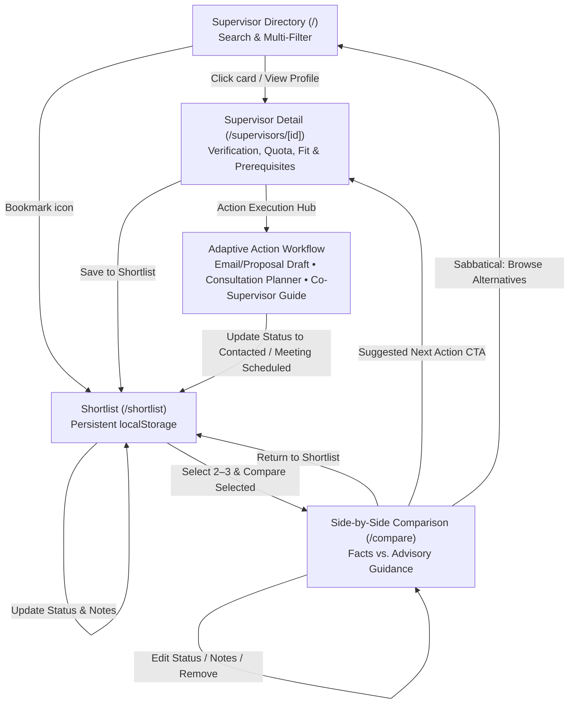

# User Flow Documentation

SVH supports a structured yet **non-linear** thesis supervisor evaluation workflow. Students can freely jump between the Directory, Detail Pages, Shortlist, and Comparison views at any point via the persistent top navigation bar or contextual links.

## End-to-End Student Journey

1. **Open Supervisor Directory (`/`):** Review overview metrics and browse faculty cards.
2. **Search & Filter:** Narrow candidates using live keyword search (name, research field, thesis topic, methodology) and verification/field/availability filters.
3. **Inspect Supervisor Profile (`/supervisors/[id]`):** Examine verification scope, information sources, freshness, advising quota, thesis focus areas, methodologies, and prerequisites.
4. **Shortlist Promising Candidates:** Save supervisors directly from directory cards or detail pages; the navbar Shortlist badge updates immediately and persists in `localStorage`.
5. **Manage Shortlist (`/shortlist`):** Review saved candidates, assign a **Decision Status** (`Considering`, `Priority Candidate`, `Contacted`, `Meeting Scheduled`, `Not Pursuing`), and record private **Decision Notes**.
6. **Select 2–3 Candidates & Compare (`/compare?ids=...`):** Evaluate candidates side-by-side across verification reliability, availability, research overlap, and rule-based **Fact** vs. **Advisory** decision guidance.
7. **Refine Evaluation:** Update statuses/notes directly on `/compare` or `/shortlist`, remove unsuitable candidates from comparison or shortlist, or return to `/` to explore additional supervisors.
8. **Execute Next Action (Action Execution Hub):** Follow the suggested next action link to the chosen supervisor's detail page to draft a pre-proposal/inquiry email, use the consultation planner, review co-supervisor guidance, or browse alternatives if a supervisor is on sabbatical.

## Workflow Diagram

> **Note:** Navigation between `/`, `/supervisors/[id]`, `/shortlist`, and `/compare` is unrestricted. Users may shortlist directly from `/` without opening a detail page, or open Action Execution Hub modals directly from a detail page without comparing first.
